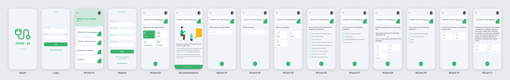

# COVID-19 Test Booking App

> 👨‍💻 Developed by **[Suresh Kumar Meesala](https://github.com/SureshKumarMeesala)** · 🎨 UI design by **Pavan Madiraju** (credits below)

A mobile app built with **React Native (0.88+)**, **Expo SDK 58+** and **Expo Router**, using **JavaScript and JSX (`.js`, `.jsx`)**. Every screen is built from the original Sketch design `covid-19-test-booking-app-pavan-madiraju.sketch` by **Pavan Madiraju**: one route per artboard, with the artboard's layout, colours, images and text.



## 📱 Screens (15 design artboards)

Listed in the order of the app's flow. "Taps" is the number of tap targets wired on the screen (buttons, tabs, back arrows, list rows).

| # | Screen (artboard) | Route | Size | Taps |
|---|---|---|---|---|
| 1 | **Splash** · start screen | `src/app/splash.jsx` | 375 × 811 | 0 |
| 2 | **Login** | `src/app/login.jsx` | 375 × 811 | 2 |
| 3 | **Wizard 01** | `src/app/wizard-01.jsx` | 375 × 811 | 5 |
| 4 | **Register** | `src/app/register.jsx` | 375 × 811 | 2 |
| 5 | **Wizard 02** | `src/app/wizard-02.jsx` | 375 × 811 | 2 |
| 6 | **Recommendations** | `src/app/recommendations.jsx` | 375 × 811 | 2 |
| 7 | **Wizard 03** | `src/app/wizard-03.jsx` | 375 × 811 | 2 |
| 8 | **Wizard 04** | `src/app/wizard-04.jsx` | 375 × 811 | 2 |
| 9 | **Wizard 05** | `src/app/wizard-05.jsx` | 375 × 811 | 2 |
| 10 | **Wizard 06** | `src/app/wizard-06.jsx` | 375 × 811 | 2 |
| 11 | **Wizard 07** | `src/app/wizard-07.jsx` | 375 × 811 | 2 |
| 12 | **Wizard 08** | `src/app/wizard-08.jsx` | 375 × 811 | 2 |
| 13 | **Wizard 09** | `src/app/wizard-09.jsx` | 375 × 811 | 2 |
| 14 | **Wizard 10** | `src/app/wizard-10.jsx` | 375 × 811 | 2 |
| 15 | **Wizard 11** | `src/app/wizard-11.jsx` | 375 × 811 | 2 |

Screenshots of every screen are in [`screenshots/`](./screenshots).

## 🧩 How it's built

- `src/screens/*.json`: each design artboard converted to screen data (vector shapes, gradients, image fills, masks, shadows, blurs and rich text, positioned as in the design), plus its tap targets
- `src/sketch/SketchScreen.jsx`: draws a screen at the device's width with `react-native-svg`, native `Text`/`TextInput` and `expo-blur`, and handles navigation between screens
- `src/app/`: Expo Router routes, one per artboard (`index.jsx` opens the start screen)
- `assets/images/`: images used by the design

## 🛠️ Tech Stack

- **Framework**: React Native 0.88+ / Expo SDK 58+
- **Navigation**: Expo Router (file-based routing)
- **Language**: JavaScript & JSX (`.js`, `.jsx`)
- **Rendering**: `react-native-svg`, `expo-blur`
- **Fonts**: Google Fonts via `@expo-google-fonts` (Inter, Nunito Sans), standing in for the design's original fonts where those aren't free

<!-- run-locally:start -->

## ▶️ Run locally

```bash
npm install
npx expo start
```

Then press `i` for the iOS simulator, `a` for Android, or `w` for the web, or scan the QR code with Expo Go.

<!-- run-locally:end -->

<!-- developer:start -->

## 👨‍💻 Developer

This React Native app was developed by **Suresh Kumar Meesala**.

| | |
|---|---|
| Developer | [Suresh Kumar Meesala](https://github.com/SureshKumarMeesala) |
| GitHub | [@SureshKumarMeesala](https://github.com/SureshKumarMeesala) |
| Organization | [FreeAppSource](https://github.com/FreeAppSource) |
| Repository | <https://github.com/FreeAppSource/covid-19-test-booking-app> |

<!-- developer:end -->

---

<!-- design-credits:start -->

## 🎨 Design Credits

This app is based on the free **COVID-19 Test Booking App** design by **Pavan Madiraju**, downloaded from Sketch App Sources. All visual design credit goes to the designer. The screens are reproduced from the original Sketch file; fonts that aren't free are replaced with similar Google Fonts, so some details may differ slightly from the original.

| | |
|---|---|
| Designer | [Pavan Madiraju](https://www.sketchappsources.com/contributor/pavanmadiraju) |
| Original design | [COVID-19 Test Booking App](https://www.sketchappsources.com/contributor/pavanmadiraju) |
| Downloaded from | [Sketch App Sources](https://www.sketchappsources.com/free-source/4363-covid-19-test-booking-app-sketch-freebie-resource.html) |
| Dribbble | <http://www.dribbble.com/pavanmadiraju> |
| Original file | `covid-19-test-booking-app-pavan-madiraju.sketch` |
| License / usage | Not stated on the page. Free download; give credit (Sketch App Sources Terms). Confirm with the designer before commercial use. |

**Attribution:**

> UI design: "COVID-19 Test Booking App" by Pavan Madiraju (http://www.dribbble.com/pavanmadiraju), downloaded from Sketch App Sources (https://www.sketchappsources.com/free-source/4363-covid-19-test-booking-app-sketch-freebie-resource.html).

The original design source files are not included in this repository; get them from the links above. This app's **code** is released under the [MIT License](./LICENSE); the visual design remains the designer's (see [NOTICE](./NOTICE)).

Photos, brand logos and avatars inside the design may belong to third parties and are not covered by the designer's permission.

<!-- design-credits:end -->
